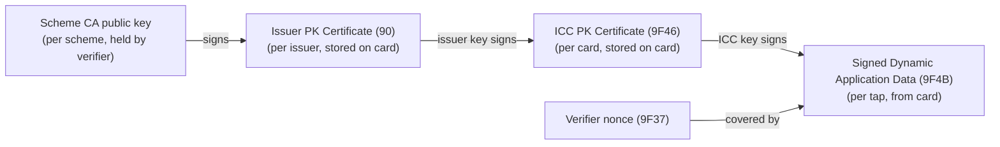

# zkEMV

Zero-knowledge proof (ZKP) of a genuine EMV contactless card signing a verifier challenge

## Introduction

A contactless EMV[^emv] card authenticates itself to a payment terminal with an RSA[^rsa] certificate chain (offline data authentication[^emv-book2]).
zkEMV proves that chain in zero knowledge[^zkp], so a verifier learns that a genuine card signed its fresh challenge (nonce) without learning any personally identifiable information (PII) like card number (formally known as primary account number or PAN), expiry or CVV.
If the verifier requests, the proof also reveals chosen attributes based on first 6-8 digits of the card (formally known as bank identification number or BIN[^bin]), such as whether it is a prepaid card or which country the card is issued in, but never the PAN or the BIN itself.
The circuits are written in Noir[^noir] and proved with ProveKit[^provekit].



Codes in parentheses are EMV tags[^emv-tags].
Each arrow is an RSA signature with public exponent 3 and ISO/IEC 9796-2[^iso9796-2] message recovery: cubing the signature modulo the signer's key yields the signed data itself (for a certificate, the next public key) together with a SHA-1[^sha1] hash that the circuit recomputes and compares.
For each signature the circuit checks the header, trailer, format, algorithm indicators, key length, exponent and embedded hash; for each certificate it also rebuilds the next key.
Across the chain, it checks that the issuer identifier matches the PAN[^pan] prefix and that neither certificate has expired.

- **Public inputs:** CA modulus, BIN table Merkle root, nonce `9F37`, current month (YYMM), scope, attributes to disclose; for Visa, also amount `9F02` and currency `5F2A`.
- **Private inputs:** the card's certificates, signature and related data; the card's BIN table range and its Merkle path.
- **Output:** the disclosed BIN attributes, and a nullifier, the Poseidon2[^poseidon2] hash of the scope and the card's ICC public key: the same for every proof of one card in one verifier scope, unlinkable across scopes.
- **Not checked:** CA key and issuer certificate revocation, contents of the signed static data. The `emv` crate checks CA key expiry, outside the circuit.

`data/certificate-authority-public-keys.json` holds scheme CA public keys, built from community-maintained lists[^emv-bertlv][^eftlab-ca-keys], keeping only keys whose published checksum verifies; not authoritative.
The verifier picks the CA keys it trusts; a production deployment of verifier should trust only the official distribution of CA keys.

The scope sets what a verifier can recognise:

| Scope | Nullifier | For |
| --- | --- | --- |
| Unlinkable | none: the prover picks a random scope | card presence, e.g. anti-bot friction |
| Verifier | the same for a card at one verifier | once per card, e.g. a free trial |
| Event | the same for a card at one verifier's event | once per card per event, e.g. a poll |

Both sides derive the scope from the verifier's origin, the prover from the one it authenticated, so a verifier can't ask for another verifier's scope.

A verifier can also ask for attributes based on card's BIN, from a BIN table it trusts, committed to by the root of a Poseidon2 Binary Merkle tree[^merkle-tree] of depth 24, one leaf per range.
The circuit reads the first 12 PAN digits from the ICC PK Certificate, which the issuer signs, and checks that they fall in a range of that table.
Ranges bound those 12 digits, so a range can stand for a 6- or 8-digit BIN or for a narrower part of one.
It reveals only the attributes asked for and zero for the others.
When none is asked for, the BIN table is not checked against.

| Attribute | Revealed as |
| --- | --- |
| Country | Issuer country, ISO 3166-1 numeric[^iso3166-1] |
| Card type | Credit, debit or prepaid |
| Brand | Its position in the table's brand list, counting from 1; the table names it, e.g. `VISA` |
| Commercial | Whether the card is issued to a business entity |

`data/bin-table.json` is such a table, built from a community-maintained BIN list[^binlist-data]; not authoritative.
The verifier picks the table it trusts with pinned root; the prover needs that exact table to get a Merkle path to its BIN range.

| Circuit | Scheme | Key widths in bits (CA / issuer / ICC) | Dynamic signature covers |
| --- | --- | --- | --- |
| `visa_fdda` | Visa fDDA | 1984 / 1408 / 1024 | `9F37 ‖ 9F02 ‖ 5F2A ‖ 9F69`[^9f69] |
| `mastercard_dda` | Mastercard DDA | 1984 / 1920 / 1152 | `9F37` |

## Prerequisites

| Tool | Version | Needed for |
| --- | --- | --- |
| GNU Make[^make] | any | The recipes below |
| Nargo[^nargo] | 1.0.0-beta.26 | Compiling and testing the circuits |
| Rust[^rustup] | 1.98.0, minimum 1.90 | The `emv` crate; rustup installs the version pinned in `emv/rust-toolchain.toml` |
| Python[^python] | 3.14 | Regenerating fixtures and circuit inputs |
| black[^black], mypy[^mypy] | As in `requirements.txt` | Linting and formatting Python sources |
| cargo-criterion[^cargo-criterion] | 1.1.0 | Benchmarking Rust library crate |
| provekit-cli[^provekit-cli] | 1.0.2 | Printing circuit statistics (`make circuit-stats`) |
| Docker[^docker], adb[^adb] | any | Benchmarking on an arm64 Android device |

## Tests

```bash
make test-circuits   # Noir circuit tests
make test-e2e        # compiles the circuits, then proves and verifies each synthetic card tap data
```

Generated files are committed. To regenerate them:

```bash
python3 circuits/scripts/gen_synthetic.py       # rewrites circuits/fixtures/ (deterministic)
python3 circuits/scripts/gen_circuit_inputs.py  # verifies each fixture natively, writes each circuit's Prover.toml and src/tests/vectors.nr
```

## Examples

```bash
make examples
```

Runs one example per scope on `visa_fdda` circuit, and one disclosing BIN table attributes on both circuits, with a mock card: a synthetic tap re-signed for each challenge under a test CA.

## Benchmarks

```bash
make circuit-stats
make bench
make bench-android
```

`circuit-stats` prints each circuit's R1CS constraint and witness counts, obtained from ProveKit.

```bash
visa_fdda
  TOTAL CONSTRAINTS:      64,702  (2^15.98)
  TOTAL WITNESSES:       112,016  (2^16.77)
mastercard_dda
  TOTAL CONSTRAINTS:      93,054  (2^16.51)
  TOTAL WITNESSES:       161,794  (2^17.30)
```

The benchmarks prove and verify each circuit's synthetic card tap data.
When benchmarking on an arm64 Android device, already connected over adb, it cross-compiles the benchmark binary with the Android NDK[^ndk] inside Docker (`Dockerfile.bench-android`).
Keep the device's screen on for the whole run, with the screen off, Android throttles the CPU and the captured timings vary several-fold.

| Environment | Circuit | Prove | Verify | Proof size |
| --- | --- | --- | --- | --- |
| Ubuntu 26.04 on Intel Core i7-1260P with 16 threads and 15GB RAM | `visa_fdda` | 621 ms | 81 ms | 613.6 KiB |
| Ubuntu 26.04 on Intel Core i7-1260P with 16 threads and 15GB RAM | `mastercard_dda` | 782 ms | 83 ms | 636.4 KiB |
| Android 16 on Samsung Galaxy S25 Ultra (Snapdragon 8 Elite) with 8 cores and 12GB RAM | `visa_fdda` | 660 ms | 85 ms | 616.6 KiB |
| Android 16 on Samsung Galaxy S25 Ultra (Snapdragon 8 Elite) with 8 cores and 12GB RAM | `mastercard_dda` | 823 ms | 91 ms | 636.2 KiB |

> [!IMPORTANT]
> None of the devices were connected to direct power during the benchmark experiments.

## FAQ

### What is zkEMV?

zkEMV produces a zero-knowledge proof (ZKP) that a genuine contactless EMV card signed a fresh challenge from a verifier, for example an Internet-based service provider.
The user taps their card on their own near field communication (NFC) capable device, and the device generates the ZKP from the captured transcript of the NFC communication.
The verifier receives a succinct proof, a domain-specific 32-byte nullifier and the card attributes that it asked to reveal.
The verifier never sees the card number, the expiry dates or any of the certificates stored on the card.
zkEMV is a local-first protocol, running entirely on user device, without ever interacting with the card issuer or the payment network to prove to the verifier that the card is genuine.

### What is an EMV card?

EMV is the standard for chip-based payment cards, from EMVCo.
EMV is an abbreviation of "Europay, Mastercard, and Visa".
When the card is tapped on a reader, for example a merchant's payment terminal, the card and the reader communicate over NFC.
They run an offline data authentication (ODA) protocol, in which the card signs a pseudorandom "nonce" (challenge) from the reader with the ICC private key held inside the card chip.
During ODA, the card shares a certificate chain that links up to a public certification authority (CA), proving that the card is genuine.
In EMV terminology, the card number is referred to as the primary account number (PAN), which is 13 to 19 digits long, most often 16.
The first 6 to 8 digits of the PAN are the bank identification number (BIN), which identifies the issuer, along with attributes such as the issuer country and the card type.

### Why is zkEMV better than giving out card details and accepting a reversible $1 charge?

If an online merchant accepts card details from its customers, it is responsible for keeping them safe from hackers.
Otherwise, a data breach might expose its customers' personally identifiable information (PII).
With zkEMV, an online merchant receives only a ZKP and an opaque 32-byte nullifier; it does not see any other card details.
Card numbers stolen in a database dump can't produce a zkEMV proof, because a proof needs a tap of the physical card with EMV chip.
For the same reason, virtual cards without an EMV chip cannot participate in the zkEMV protocol.
zkEMV empowers both the merchant and the customer in different ways: a privacy-conscious customer does not need to trust online service providers to handle card details carefully, and the merchant does not need to take on the responsibility of handling PII.
In short, it reduces both parties' exposure to data breaches.

### Does generating a zkEMV proof charge my card?

No.
zkEMV is an offline protocol built on top of EMV's offline data authentication: it does not need to talk to the card issuer or the payment network.
On Visa cards, which implement ODA as fast dynamic data authentication (fDDA), each tap also produces a payment cryptogram (ARQC) for the requested amount and currency, and increments the on-chip transaction counter by one.
The zkEMV mobile application running on the user's device discards that ARQC, so no charge occurs.
But this exposes the card to cloning attacks[^pre-play] if the app or the device itself is malicious.

### Does zkEMV work for in-store payments?

No.
zkEMV proves to a verifier that a user tapped a genuine card on their device without ever giving out the card details or communicating with the card network.
It is useful for use cases where no money needs to move; instead, a card authorization is used to limit bots and repeat users.
For in-store merchants, the payment terminal communicates with the card and sends the captured payment cryptogram (ARQC) to the payment network so that the card can be charged.
zkEMV does not hide the user from the payment network; instead, it protects user privacy from online merchants that card-gate their services but are prone to customer data leaks.

### What does the verifier learn from a zkEMV proof?

The verifier learns:

- That a genuine card signed its challenge nonce, and that none of its certificates has expired.
- A deterministic scoped nullifier of the card, useful for the verifier to prevent replay attacks from malicious users.
- Any of the additional card attributes the verifier asked to reveal, such as the issuer name, the issuer country or the funding type of the card.

The phone on which the user tapped their card sees the PAN, the expiry dates, all certificates and the card-specific ICC public key.
None of those need to be sent to the verifier.

### Why can't the verifier accept a card's certificates as proof that it is genuine?

An EMV card carries two certificates: the issuer certificate and the ICC certificate.
The certification authority (CA) signs the issuer certificate, which contains the issuer public key.
The CA public key is the trust anchor.
The issuer signs the ICC certificate, which contains the card-specific ICC public key, the PAN and the expiry date of the certificate.
At the end of the certificate chain, the card signs the challenge nonce with its ICC private key.

A verifier that sees the raw certificate chain learns the PAN and the expiry date, defeating the whole purpose of respecting user privacy.
The verifier also learns the ICC public key, which stays with the card for its lifetime.
Instead, zkEMV wraps the offline data authentication protocol of EMV cards inside a zero-knowledge proof, revealing as little data as possible to the verifier.

### What is a nullifier in the context of zkEMV?

A nullifier is a 32-byte value that identifies a card within a verifier scope.
It is the Poseidon2 hash of the scope bytestring and the card-specific ICC public key.
The same card produces the same nullifier for the same verifier scope, and nullifiers are unlinkable across scopes.
A nullifier is useful for the verifier to deduplicate cards and stop an existing user from posing as a new user, which is known as a Sybil attack.
Because the scope is chosen by the verifier, it is important to authenticate the verifier's request origin to prevent a verifier from learning the nullifier designated for another verifier's scope.
If nullifier databases leak, a malicious verifier can link the presence of the same cardholder across merchants.
Hence, the user's device must authenticate the verifier's origin before handing over a ZKP for the requested scope.

### What additional card attributes can a zkEMV proof disclose?

The first 6 to 8 digits of an EMV card number, referred to as the BIN, encode the issuer name, the issuer country, card type (credit, debit or prepaid) and whether it is a commercial card.
It is possible to selectively disclose some of these attributes without leaking the BIN or the whole PAN, by showing a Merkle inclusion proof against the root hash of a public BIN table.
The Merkle tree, which the verifier and the user agree on before running the zkEMV protocol, is built over ranges of the first 12 digits of the PAN.
EMV specifies that a BIN can be up to the first 12 digits of the card number, though for most cards in circulation it is up to 8 digits today.

### What are the security assumptions zkEMV relies on?

zkEMV wraps EMV's offline data authentication protocol in a zero-knowledge proof, so it inherits the same security argument.
ODA uses the SHA-1 hash function for data integrity, which has a practical chosen-prefix collision attack[^sha1-collision].
To fake either certificate, the issuer certificate or the ICC certificate, an attacker must get the certification authority (CA) or the issuer, respectively, to sign a message of the attacker's choice.
ISO/IEC 9796-2 has forgery attacks on EMV signatures[^iso9796-2-forgery].
For these attacks to be practical, the attacker needs to harvest signatures on many messages of its choice, but the CA and the issuer keys sign only the certificates that their owners intend to issue.
EMVCo expects 1984-bit RSA keys to stay safe until at least 2036[^emvco-key-lengths], even though the RSA-896 challenge number was recently factored, setting a new record[^rsa-896].
EMV limits the challenge nonce to only 4 bytes.
If an attacker collects $k$ signatures over $k$ nonces, it can answer a zkEMV verifier's challenge only if the challenge nonce is one of those $k$ nonces.
The attacker has a success probability of $k \cdot 2^{-32}$ per challenge.
Since an honest verifier selects the nonce at random, the attacker has no control over it.

### What are the privacy guarantees of zkEMV?

zkEMV keeps card data private only from verifiers, not from the card issuer or the payment network.
Your phone can generate a zkEMV proof fully offline, without communicating with the issuer or the payment network, so no change is required on their side.
But the issuer and any payment terminal that has already read the EMV card know the card-specific ICC public key.
They can calculate the nullifier for any verifier scope, which lets them link user presence across merchants if they get hold of the merchants' nullifier databases.
A tap does not need a PIN, so a person who has the card for a short while can produce a proof and present it to the verifier as if the cardholder intended to do so.
This lets a malicious intermediary skim the card and claim free-trial benefits in the actual cardholder's name, possibly without their knowledge, or take a destructive action gated behind two-factor authentication (2FA).

### Which cards are supported by zkEMV today?

zkEMV supports contactless EMV cards from Visa and Mastercard.
Only physical cards can be tapped to produce a zkEMV proof.
Digital cards like those stored in Google Pay or Apple Pay are tokens; they do not implement EMV ODA.
iOS lets only approved apps communicate with payment cards over NFC, so zkEMV currently supports only Android.

## License

Licensed under either of Apache License 2.0 (`LICENSE-APACHE`) or MIT license (`LICENSE-MIT`), at your option.
Unless you explicitly state otherwise, any contribution intentionally submitted for inclusion in this work, as defined in the Apache-2.0 license, shall be dual licensed as above, without any additional terms or conditions.

`data/bin-table.json` is derived from binlist-data[^binlist-data], licensed under CC BY 4.0[^cc-by-4], and reformatted into PAN prefix ranges.
`data/certificate-authority-public-keys.json` is compiled from emv-bertlv[^emv-bertlv] and EFTlab's list of CA public keys[^eftlab-ca-keys].

## References

[^emv]: EMV. Wikipedia. <https://en.wikipedia.org/wiki/EMV>
[^rsa]: RSA cryptosystem. Wikipedia. <https://en.wikipedia.org/wiki/RSA_cryptosystem>
[^emv-book2]: EMV Book 2: Security and Key Management. EMVCo. <https://www.emvco.com/specifications/book-2-security-and-key-management/>
[^zkp]: Zero-knowledge proof. Wikipedia. <https://en.wikipedia.org/wiki/Zero-knowledge_proof>
[^noir]: Noir. <https://noir-lang.org>
[^provekit]: ProveKit. <https://docs.provekit.org/>
[^emv-tags]: Complete list of EMV & NFC tags. EFTlab. <https://www.eftlab.com/knowledge-base/complete-list-of-emv-nfc-tags>
[^iso9796-2]: ISO/IEC 9796-2:2010, Digital signature schemes giving message recovery, Part 2: Integer factorization based mechanisms. <https://www.iso.org/standard/54788.html>
[^sha1]: SHA-1. Wikipedia. <https://en.wikipedia.org/wiki/SHA-1>
[^pan]: Payment card number. Wikipedia. <https://en.wikipedia.org/wiki/Payment_card_number>
[^bin]: Bank identification number, the PAN's leading digits that identify the issuer. Wikipedia. <https://en.wikipedia.org/wiki/Payment_card_number#Issuer_identification_number_(IIN)>
[^poseidon2]: Grassi, Khovratovich, Schofnegger. Poseidon2: A Faster Version of the Poseidon Hash Function. <https://eprint.iacr.org/2023/323>
[^emv-bertlv]: emv-bertlv, `ca-public-keys.txt`. binaryfoo. <https://github.com/binaryfoo/emv-bertlv/blob/master/src/main/resources/ca-public-keys.txt>
[^eftlab-ca-keys]: List of CA public keys. EFTlab. <https://www.eftlab.co.uk/knowledge-base/list-of-ca-public-keys>
[^merkle-tree]: Merkle tree. Wikipedia. <https://en.wikipedia.org/wiki/Merkle_tree>
[^iso3166-1]: ISO 3166-1 numeric. Wikipedia. <https://en.wikipedia.org/wiki/ISO_3166-1_numeric>
[^binlist-data]: binlist-data. Techbuddie Solutions. <https://github.com/Techbuddie-Solutions/binlist-data>
[^9f69]: `9F69`, Card Authentication Related Data: fDDA version number, card unpredictable number and card transaction qualifiers. EMV Book C-3: Kernel 3 Specification. EMVCo. <https://www.emvco.com/specifications/book-c-3-kernel-3-specification/>
[^make]: GNU Make. <https://www.gnu.org/software/make/>
[^nargo]: Nargo, the Noir toolchain. <https://noir-lang.org/docs>
[^rustup]: rustup, the Rust toolchain installer. <https://rustup.rs>
[^python]: Python. <https://www.python.org>
[^black]: Black, the Python code formatter. <https://github.com/psf/black>
[^mypy]: mypy, a static type checker for Python. <https://mypy-lang.org>
[^cargo-criterion]: cargo-criterion. <https://github.com/bheisler/cargo-criterion>
[^provekit-cli]: provekit-cli, ProveKit's command-line tool. <https://crates.io/crates/provekit-cli>
[^docker]: Docker. <https://www.docker.com>
[^ndk]: Android NDK. <https://developer.android.com/ndk>
[^adb]: Android Debug Bridge. <https://developer.android.com/tools/adb>
[^sha1-collision]: Leurent, Peyrin. SHA-1 is a Shambles: First Chosen-Prefix Collision on SHA-1 and Application to the PGP Web of Trust. USENIX Security 2020. <https://www.usenix.org/conference/usenixsecurity20/presentation/leurent>
[^iso9796-2-forgery]: Coron, Naccache, Tibouchi, Weinmann. Practical Cryptanalysis of ISO/IEC 9796-2 and EMV Signatures. CRYPTO 2009. <https://doi.org/10.1007/978-3-642-03356-8_25>
[^emvco-key-lengths]: EMVCo Annual Public Key Lengths Assessment. EMVCo. <https://www.emvco.com/specifications/kl-bulletin-no30-emvco-annual-public-key-lengths-assessment>
[^pre-play]: Bond, Choudary, Murdoch, Skorobogatov, Anderson. Chip and Skim: Cloning EMV Cards with the Pre-play Attack. IEEE S&P 2014. <https://doi.org/10.1109/SP.2014.11>
[^cc-by-4]: Creative Commons Attribution 4.0 International. <https://creativecommons.org/licenses/by/4.0/>
[^rsa-896]: RSA-896. Stephen A. Weis. <https://saweis.net/posts/rsa-896.html>
